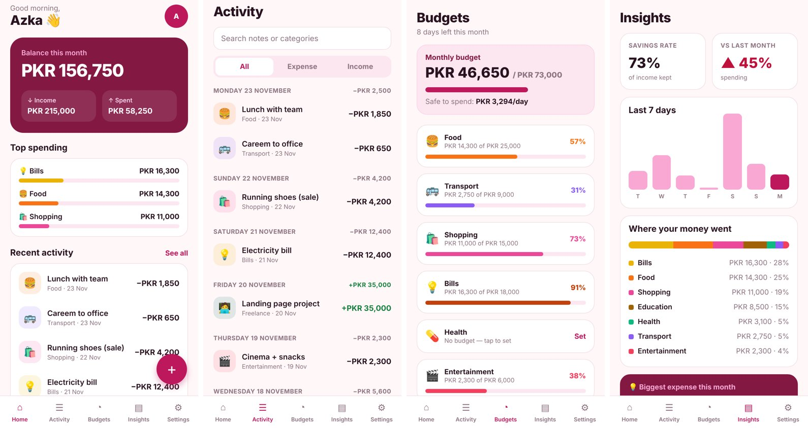
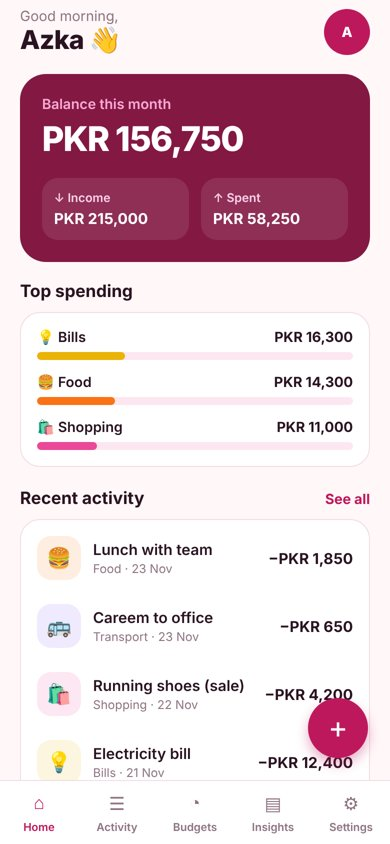
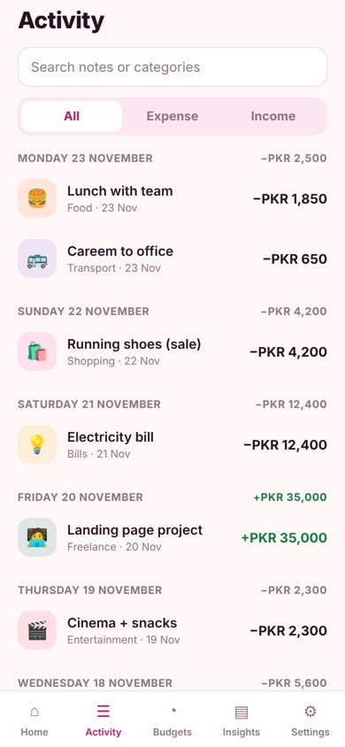
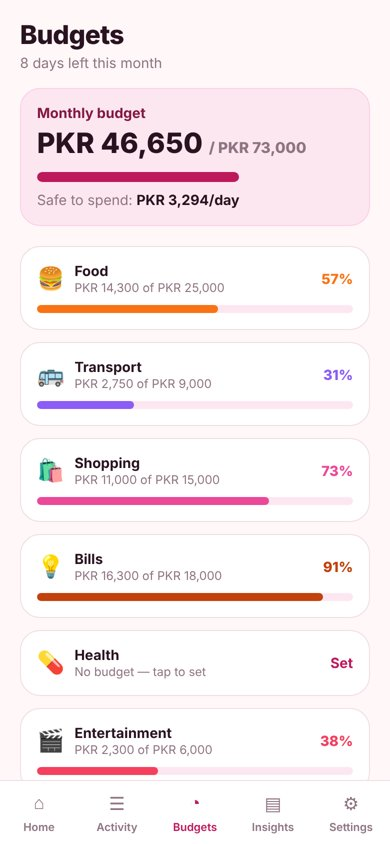
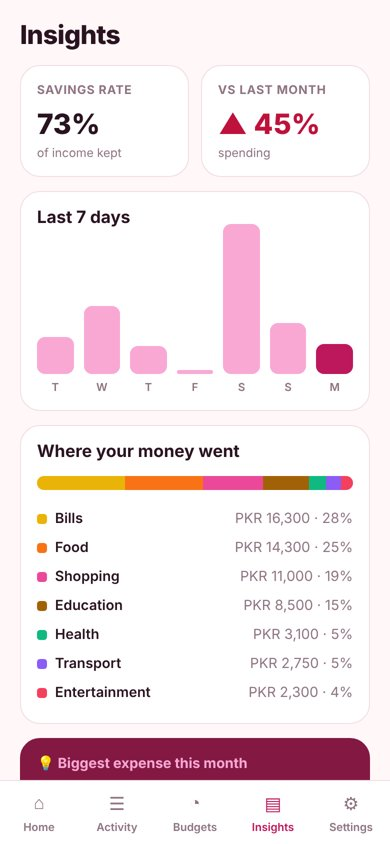

<div align="center">

# 🌸 SpendWise — Personal Finance App (React Native)

**Track spending, set category budgets and see where your money goes — on Android, iOS and web from one codebase.**




</div>

---

## ✨ Features

| Screen | What it does |
|---|---|
| **Home** | Monthly balance card, income vs spent, top spending categories, over-budget warning, recent activity, floating “+” button |
| **Activity** | Transactions grouped by day with daily net, search, All / Expense / Income filter |
| **Add transaction** | Modal with expense/income toggle, large amount input, category grid, quick date chips, validation |
| **Transaction detail** | Full details and delete with confirmation |
| **Budgets** | Per-category limits with colour-coded progress, total budget and **“safe to spend per day”** for the rest of the month, bottom-sheet editor |
| **Insights** | Savings rate, month-over-month change, 7-day spending chart, category breakdown bar, biggest expense |
| **Settings** | Name, currency (PKR / AED / USD / GBP / EUR), CSV export, load sample data, clear data |

### Engineering highlights

- **State management** with `useReducer` + Context, persisted to **AsyncStorage** (works offline, survives restarts).
- **Navigation:** bottom tabs nested inside a native stack, with a modal presentation for “Add transaction”.
- **Pure selectors** (`monthSummary`) keep screens simple and testable.
- **Platform-aware code** — native `Alert` on mobile, `window.confirm` / file download on web.
- Charts and progress bars built from plain `View`s — no chart library needed.
- Store-ready config in `app.json` (bundle IDs, version / build numbers).

## 📸 Screens

| Home | Activity | Budgets | Insights |
|---|---|---|---|
|  |  |  |  |

## 🚀 Run it

```bash
npm install
npx expo start
```

Then press **a** for Android emulator, **i** for iOS simulator, **w** for web — or scan the QR code with the **Expo Go** app on your phone.

### Build for the stores (EAS)

```bash
npm install -g eas-cli
eas build --platform android   # .aab for Google Play
eas build --platform ios       # .ipa for App Store / TestFlight
```

## 🗂 Structure

```
App.js                      navigation (stack + tabs)
src/
├── screens/                Home · Transactions · AddTransaction · TransactionDetail · Budgets · Insights · Settings
├── components/             TransactionRow · ProgressBar
├── store.js                reducer, AsyncStorage persistence, selectors
├── theme.js                colours, categories, shared styles
└── sampleData.js           demo transactions & budgets
```

## 🛣 Roadmap

- Recurring transactions & reminders (expo-notifications)
- Biometric lock (expo-local-authentication)
- Cloud sync with a Node.js / MongoDB backend
- Jest + React Native Testing Library tests

## 👩‍💻 Author

**Azka Abdul Ghafoor** · 📧 aazka4473@gmail.com

<sub>MIT licensed.</sub>
